<div align="center">

# 🧠 CodeMind AI

### AI-Powered Code Repository Assistant & Personalized Programming Learning Platform

**Understand Code. Learn Intelligently. Grow Continuously.**

<br>


<br>

[](https://vanish-stood-overhead.ngrok-free.dev)

[Features](#key-features) •
[Architecture](#system-architecture) •
[AI Workflows](#repository-assistant) •
[Screenshots](#application-screenshots) •
[Installation](#installation-and-setup) •
[Deployment](#production-deployment)

<br>

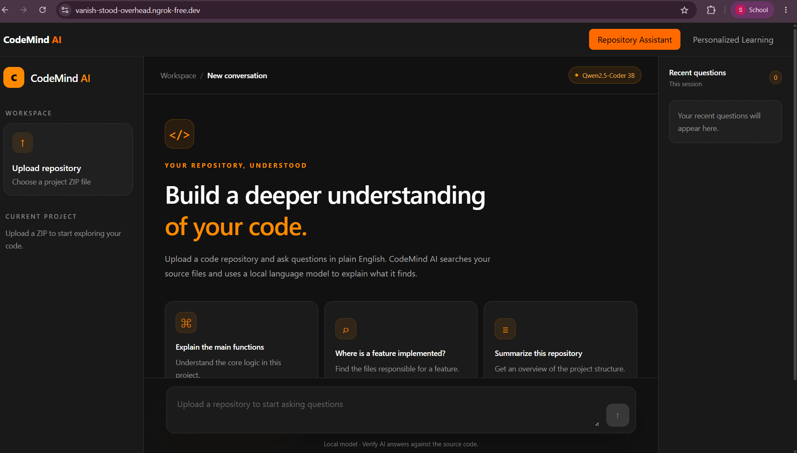

<br>

| AI Workspaces | Programming Languages | Learning Roadmap | Retrieval Methods |
| :---: | :---: | :---: | :---: |
| **2** | **5** | **30 Days** | **3** |

</div>

---

<a id="project-overview"></a>

## 📖 Project Overview

**CodeMind AI** is a full-stack artificial intelligence platform designed to simplify software repository understanding and deliver personalized programming education.

The platform integrates **Retrieval-Augmented Generation (RAG), hybrid information retrieval, local large language models, cloud-based AI inference, and adaptive learning** into a unified application.

CodeMind AI provides two independent workspaces:

<table>
<tr>
<td width="50%" valign="top">

### 🔍 Repository Assistant

An intelligent code analysis workspace that enables users to upload software repositories, understand project architecture, explore source code, and receive context-aware AI answers supported by source references.

**Powered by:**

- Qwen 2.5 Coder 3B
- Ollama
- SentenceTransformers
- BM25
- Reciprocal Rank Fusion

**Access:** No mandatory login

</td>
<td width="50%" valign="top">

### 🎓 Personalized Learning

An adaptive programming education workspace that evaluates existing knowledge, generates personalized learning roadmaps, delivers structured lessons, and tracks skill development through assessments.

**Powered by:**

- GPT-OSS 120B
- Groq API
- AI-assisted evaluation
- Topic mastery analysis
- Adaptive learning

**Access:** User authentication

</td>
</tr>
</table>

---

## 🌐 Live Demo

<div align="center">

### [🚀 Launch CodeMind AI](https://vanish-stood-overhead.ngrok-free.dev)


</div>

The application is deployed using a production React build, Django, Waitress, Caddy, and an ngrok HTTPS tunnel.

> [!NOTE]
> The application is self-hosted and accessible while the host machine and required services are running. First-time visitors may encounter an ngrok browser warning page. Select **Visit Site** to continue.

---

## 📑 Table of Contents

- [Project Overview](#project-overview)
- [Key Features](#key-features)
- [System Architecture](#system-architecture)
- [Repository Assistant](#repository-assistant)
- [Personalized Learning](#personalized-learning)
- [AI Models and Retrieval Strategy](#ai-models-and-retrieval-strategy)
- [Retrieval Performance Evaluation](#retrieval-performance-evaluation)
- [Technology Stack](#technology-stack)
- [Application Screenshots](#application-screenshots)
- [Project Structure](#project-structure)
- [Installation and Setup](#installation-and-setup)
- [Production Deployment](#production-deployment)
- [Security and Resource Management](#security-and-resource-management)
- [Current Limitations](#current-limitations)
- [Future Enhancements](#future-enhancements)
- [Acknowledgements](#acknowledgements)

---

<a id="key-features"></a>

## ✨ Key Features

### 🔍 Repository Assistant

| Feature | Description |
| :--- | :--- |
| Repository Upload | Upload software repositories using ZIP archives. |
| Secure Extraction | Validate archives and extract supported source files. |
| Code Analysis | Analyze Python code using AST-based parsing and chunking. |
| Semantic Search | Retrieve contextually relevant code using vector embeddings. |
| Keyword Search | Identify relevant source code using BM25. |
| Hybrid Retrieval | Combine keyword and semantic rankings using RRF. |
| AI Question Answering | Generate repository-aware answers using local Qwen inference. |
| Source References | Display relevant source file references alongside answers. |
| Session Isolation | Restrict uploaded repository access to the associated session. |
| Workspace Persistence | Preserve workspace state across browser refreshes. |

### 🎓 Personalized Learning

| Feature | Description |
| :--- | :--- |
| User Authentication | Secure registration and login. |
| Language Selection | Learn C++, Python, JavaScript, Java, or SQL. |
| Diagnostic Assessment | Evaluate existing programming knowledge. |
| Skill Classification | Identify beginner, intermediate, or advanced proficiency. |
| Personalized Roadmap | Generate an AI-powered 30-day learning plan. |
| Daily Lessons | Study structured explanations and programming examples. |
| Practical Exercises | Reinforce concepts through coding activities. |
| Daily Assessments | Evaluate conceptual and practical understanding. |
| Adaptive Learning | Adjust upcoming topics based on performance. |
| Learning Dashboard | Track completion, assessment scores, and topic mastery. |

### 🛡️ Platform Features

- Responsive React and TypeScript interface.
- Independent AI-powered workspaces.
- Local and cloud AI integration.
- Secure session management.
- API rate limiting and concurrency protection.
- Automatic inactive repository cleanup.
- HTTPS-enabled public deployment.

---

<a id="system-architecture"></a>

## 🏗️ System Architecture

<div align="center">

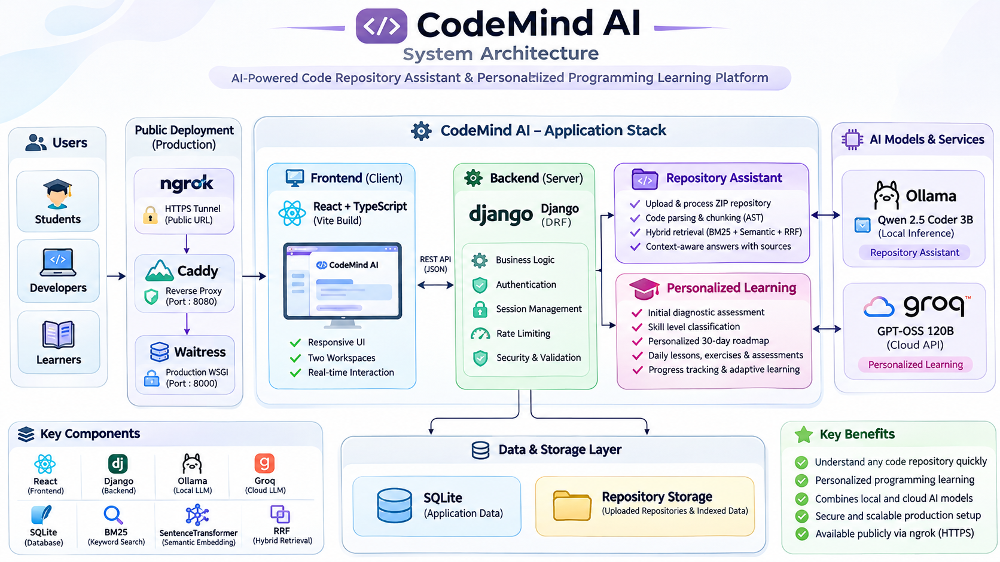

<p><em>Figure 1 — High-level system architecture of CodeMind AI</em></p>

</div>

### Architecture Components

| Layer | Responsibility |
| :--- | :--- |
| Presentation Layer | React and TypeScript provide the interactive user interface. |
| Deployment Layer | ngrok exposes the application through a public HTTPS endpoint. |
| Reverse Proxy | Caddy serves the frontend and forwards API requests to Waitress. |
| Application Layer | Django and Django REST Framework manage application logic and APIs. |
| Retrieval Layer | BM25, semantic embeddings, and RRF identify relevant repository context. |
| AI Inference Layer | Ollama provides local Qwen inference, while Groq provides GPT-OSS inference. |
| Security Layer | Authentication, sessions, CSRF protection, validation, and rate limiting. |
| Storage Layer | SQLite stores application data, while repository files and indexes use local storage. |

### Architectural Highlights

- Modular frontend and backend architecture.
- Independent repository analysis and personalized learning pipelines.
- Local inference for repository question answering.
- Cloud inference for personalized learning.
- Retrieval-augmented code understanding.
- Centralized application security and resource management.

The current architecture is designed for controlled demonstrations and educational use on a self-hosted machine.

---

<a id="repository-assistant"></a>

## 🔍 Repository Assistant

The Repository Assistant enables developers and students to understand unfamiliar software repositories without manually examining every source code file.

### Repository Processing Pipeline

```mermaid
flowchart LR
    A["Upload ZIP"] --> B["Validate Archive"]
    B --> C["Extract Files"]
    C --> D["Parse Source Code"]
    D --> E["Generate Chunks"]
    E --> F["Generate Embeddings"]
    F --> G["Repository Ready"]

    classDef input fill:#dbeafe,stroke:#60a5fa,color:#1e3a8a
    classDef process fill:#ede9fe,stroke:#a78bfa,color:#4c1d95
    classDef output fill:#dcfce7,stroke:#4ade80,color:#14532d

    class A input
    class B,C,D,E,F process
    class G output
```

### AI Question Answering Pipeline

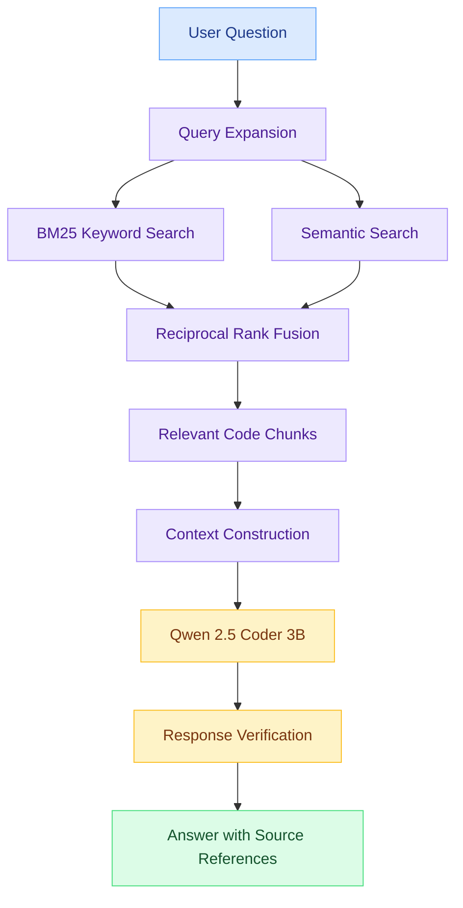

### How It Works

1. Upload a ZIP archive containing a software repository.
2. Validate and securely extract supported files.
3. Parse source code into meaningful chunks.
4. Generate and store semantic embeddings.
5. Accept a repository-related user question.
6. Retrieve relevant chunks using BM25 and semantic search.
7. Combine retrieval rankings using Reciprocal Rank Fusion.
8. Construct contextual evidence for the Qwen model.
9. Generate and verify the response.
10. Display the answer with relevant source references.

### Supported File Types

| Category | Extensions |
| :--- | :--- |
| Python | `.py` |
| JavaScript | `.js`, `.jsx` |
| TypeScript | `.ts`, `.tsx` |
| Web Development | `.html`, `.css` |
| Configuration | `.json`, `.yml` |
| Documentation | `.md`, `.txt` |

### Example Questions

- What is the purpose of this project?
- Explain the overall system architecture.
- How does the authentication system work?
- Which file contains the main application logic?
- Explain the database models used in this repository.
- How does the frontend communicate with the backend?
- Which technologies are used in this project?
- Explain a specific function or class.

---

<a id="personalized-learning"></a>

## 🎓 Personalized Learning

The Personalized Learning workspace delivers a structured programming education experience tailored to the user's existing knowledge, learning progress, and assessment performance.

### Supported Programming Languages

<div align="center">


</div>

### Personalized Learning Workflow

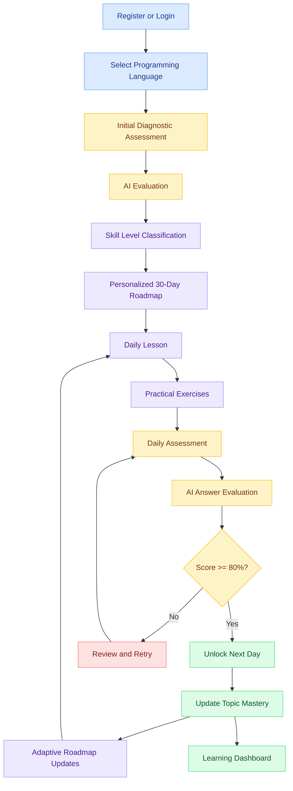

### 1. Initial Diagnostic Assessment

The initial assessment evaluates existing programming knowledge before generating the personalized roadmap.

| Parameter | Configuration |
| :--- | :---: |
| Total Questions | 15 |
| Multiple Choice Questions | 12 |
| Written Questions | 3 |
| Basic Questions | 8 |
| Intermediate Questions | 7 |
| Total Marks | 21 |

### 2. Skill Level Classification

| Assessment Score | Skill Level |
| :--- | :--- |
| Below 40% | 🟢 Beginner |
| 40% to below 75% | 🟡 Intermediate |
| 75% and above | 🔵 Advanced |

### 3. Personalized 30-Day Roadmap

The AI generates a structured learning plan based on the initial assessment results.

Each roadmap contains:

- Daily learning topics.
- Learning objectives.
- Topic difficulty.
- Estimated learning duration.
- Programming concepts.
- Practical learning activities.

### 4. Daily Learning Experience

Each learning day provides:

- Detailed concept explanations.
- Programming examples.
- Practical coding exercises.
- Daily assessment questions.
- AI-generated evaluation and feedback.

### 5. Daily Assessment

| Parameter | Configuration |
| :--- | :---: |
| Total Questions | 5 |
| Multiple Choice Questions | 3 |
| Coding Questions | 1 |
| Theory Questions | 1 |
| Total Marks | 9 |
| Passing Score | **80%** |

Written answers are evaluated using correctness, logical understanding, and clarity.

Users must achieve the required passing score to unlock the next learning day.

### 6. Adaptive Learning

The platform analyzes assessment results and topic mastery to adjust eligible upcoming learning topics.

This allows the learning experience to respond to individual strengths, weaknesses, and progress instead of following a completely static curriculum.

### 7. Learning Dashboard

The dashboard provides insights into:

- Overall course completion.
- Completed and remaining learning days.
- Average assessment performance.
- Learning streak.
- Topic-wise mastery.
- Learning activity.
- Current learning progress.

---

<a id="ai-models-and-retrieval-strategy"></a>

## 🤖 AI Models and Retrieval Strategy

### AI Model Integration

| Model | Purpose | Execution |
| :--- | :--- | :--- |
| **Qwen 2.5 Coder 3B** | Repository question answering and code understanding | Local — Ollama |
| **all-MiniLM-L6-v2** | Semantic text and code embeddings | Local — SentenceTransformers |
| **GPT-OSS 120B** | Assessments, roadmaps, lessons, evaluation, and adaptive learning | Cloud — Groq API |

### Retrieval-Augmented Generation

CodeMind AI uses **Retrieval-Augmented Generation (RAG)** to provide repository-aware answers.

Rather than relying exclusively on the language model's existing knowledge, the application retrieves relevant source code and supplies it as contextual evidence during answer generation.

### Hybrid Retrieval Strategy

<table>
<tr>
<td width="33%" valign="top">

### 🔎 BM25

Keyword-based retrieval that identifies relevant code chunks using lexical matching.

Useful for function names, variables, classes, and technical identifiers.

</td>
<td width="33%" valign="top">

### 🧠 Semantic Search

Vector-based retrieval using SentenceTransformer embeddings and cosine similarity.

Useful for conceptual and natural-language questions.

</td>
<td width="33%" valign="top">

### 🔗 RRF

Reciprocal Rank Fusion combines keyword and semantic retrieval rankings.

Improves retrieval coverage and ranking quality.

</td>
</tr>
</table>

### Retrieval Architecture

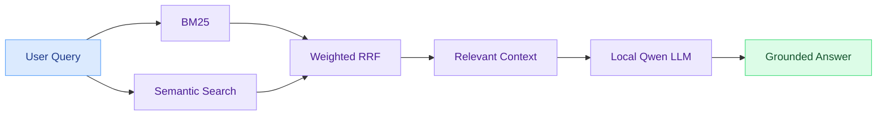

---

<a id="retrieval-performance-evaluation"></a>

## 📊 Retrieval Performance Evaluation

The retrieval pipeline was evaluated using three information retrieval metrics:

- **Precision:** Proportion of retrieved results that are relevant.
- **Recall:** Proportion of relevant results successfully retrieved.
- **Mean Reciprocal Rank (MRR):** Measures the ranking position of the first relevant result.

### Evaluation Results

| Retrieval Method | Precision | Recall | MRR |
| :--- | :---: | :---: | :---: |
| BM25 | 20.00% | 39.33% | 40.00% |
| Semantic Search | 30.00% | 61.00% | 75.00% |
| **Hybrid Search** | **30.00%** | **72.83%** | **80.83%** |

### Recall Comparison

```text
BM25              ████████              39.33%
Semantic Search   ████████████          61.00%
Hybrid Search     ███████████████       72.83%
```

### Mean Reciprocal Rank Comparison

```text
BM25              ████████              40.00%
Semantic Search   ███████████████       75.00%
Hybrid Search     ████████████████      80.83%
```

<div align="center">


</div>

### Key Findings

- Hybrid retrieval achieved the highest recall.
- Hybrid retrieval achieved the highest Mean Reciprocal Rank.
- Recall improved by 33.50 percentage points compared with BM25.
- MRR improved by 40.83 percentage points compared with BM25.
- Semantic and hybrid retrieval achieved the same precision in this evaluation.

> [!NOTE]
> These results represent retrieval performance on the project's evaluation queries. They do not represent overall AI-generated answer accuracy or a general-purpose benchmark.

---

<a id="technology-stack"></a>

## 🛠️ Technology Stack

### Frontend

<div align="center">


</div>

### Backend and Database

<div align="center">


</div>

### Artificial Intelligence and Retrieval

<div align="center">


</div>

### Deployment and Development

<div align="center">


</div>

### Complete Technology Overview

| Layer | Technologies |
| :--- | :--- |
| Frontend | React.js, TypeScript, Vite |
| Styling | Tailwind CSS, CSS |
| Backend | Python, Django, Django REST Framework |
| Database | SQLite |
| Local LLM | Ollama, Qwen 2.5 Coder 3B |
| Cloud LLM | Groq API, GPT-OSS 120B |
| Embeddings | SentenceTransformers, all-MiniLM-L6-v2 |
| Keyword Retrieval | BM25 |
| Semantic Retrieval | Cosine Similarity |
| Hybrid Retrieval | Weighted Reciprocal Rank Fusion |
| Code Analysis | Python AST, Source Code Chunking |
| Numerical Processing | NumPy |
| Production Server | Waitress |
| Reverse Proxy | Caddy |
| Public Deployment | ngrok HTTPS Tunnel |
| Version Control | Git, GitHub |

---

<a id="application-screenshots"></a>

## 📸 Application Screenshots

### 🔍 Module 1 — Repository Assistant

<div align="center">

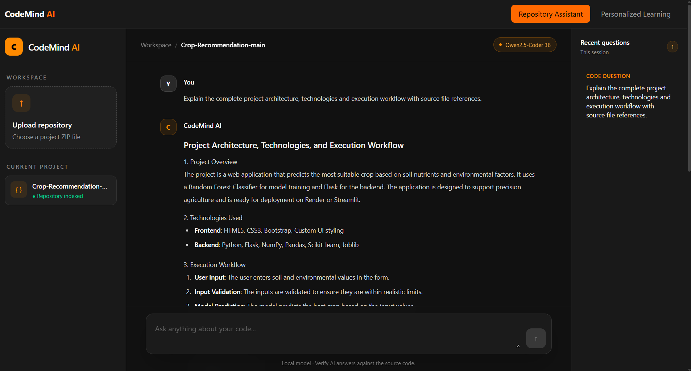

<p><strong>Intelligent Repository Question Answering</strong></p>

<p><em>Context-aware AI responses generated using hybrid retrieval and local Qwen inference, supported by source file references.</em></p>

</div>

---

### 🎓 Module 2 — Personalized Learning

#### Authentication and Language Selection

<table>
<tr>
<td width="50%" align="center">

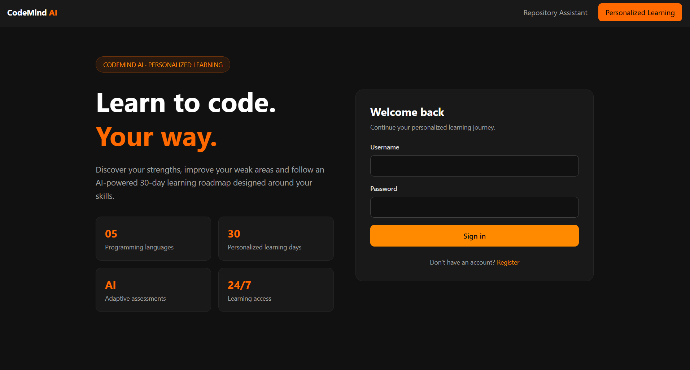

<br>

<strong>User Authentication</strong>

<br>

<sub>Secure access to the personalized learning workspace.</sub>

</td>
<td width="50%" align="center">

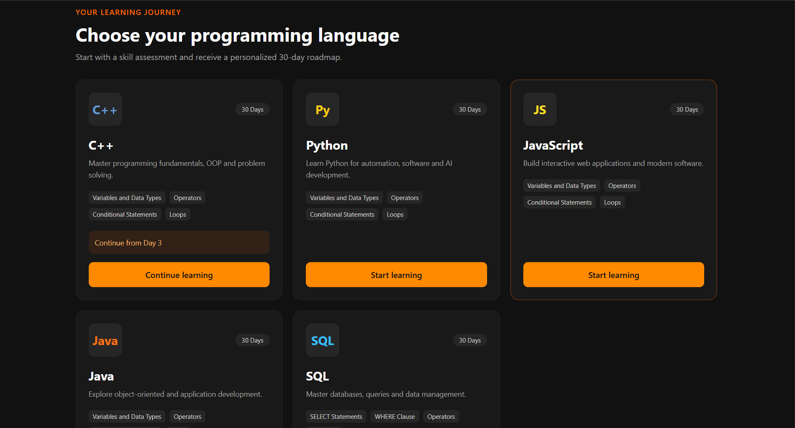

<br>

<strong>Programming Language Selection</strong>

<br>

<sub>Choose from five supported programming languages.</sub>

</td>
</tr>
</table>

#### Diagnostic Assessment and Personalized Roadmap

<table>
<tr>
<td width="50%" align="center">

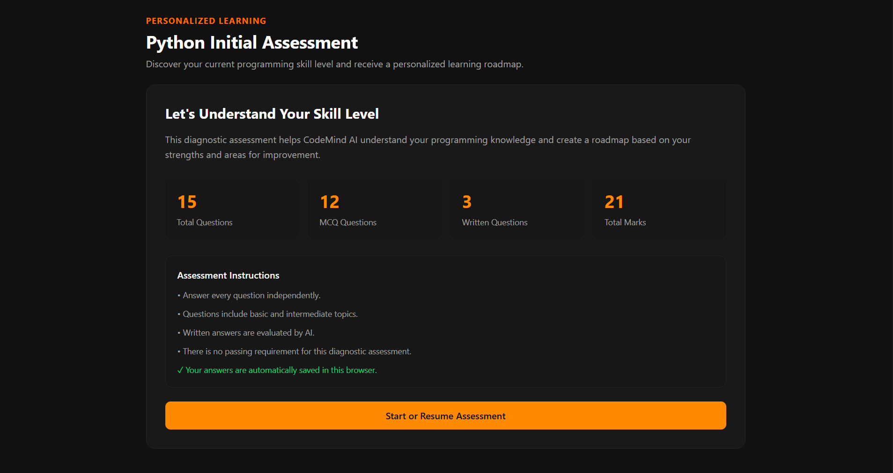

<br>

<strong>Initial Diagnostic Assessment</strong>

<br>

<sub>AI-generated assessment to identify existing knowledge and skill level.</sub>

</td>
<td width="50%" align="center">

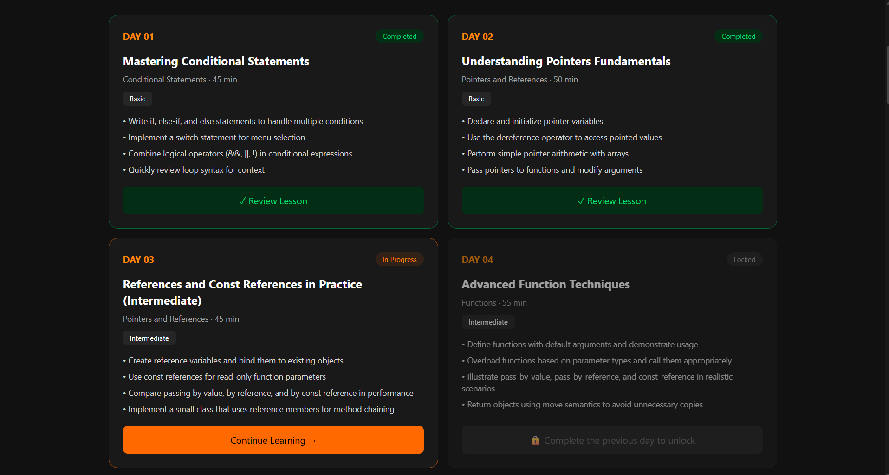

<br>

<strong>Personalized 30-Day Roadmap</strong>

<br>

<sub>Structured learning plan generated from assessment performance.</sub>

</td>
</tr>
</table>

#### Daily Lessons and Practical Exercises

<table>
<tr>
<td width="50%" align="center">

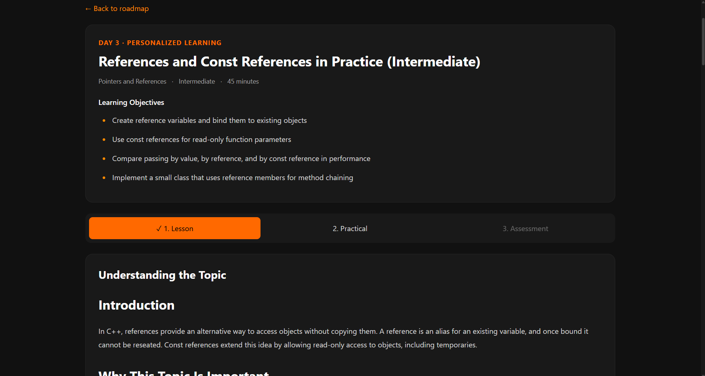

<br>

<strong>AI-Generated Daily Lessons</strong>

<br>

<sub>Detailed explanations and programming examples.</sub>

</td>
<td width="50%" align="center">

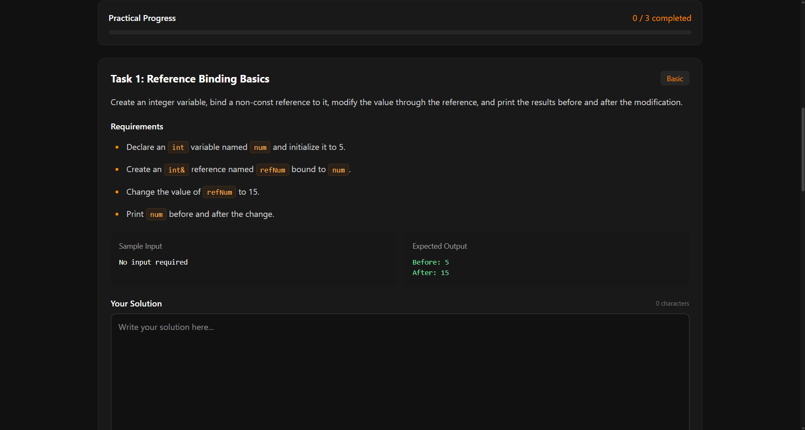

<br>

<strong>Practical Coding Exercises</strong>

<br>

<sub>Hands-on activities to reinforce programming concepts.</sub>

</td>
</tr>
</table>

#### Daily Assessment

<div align="center">

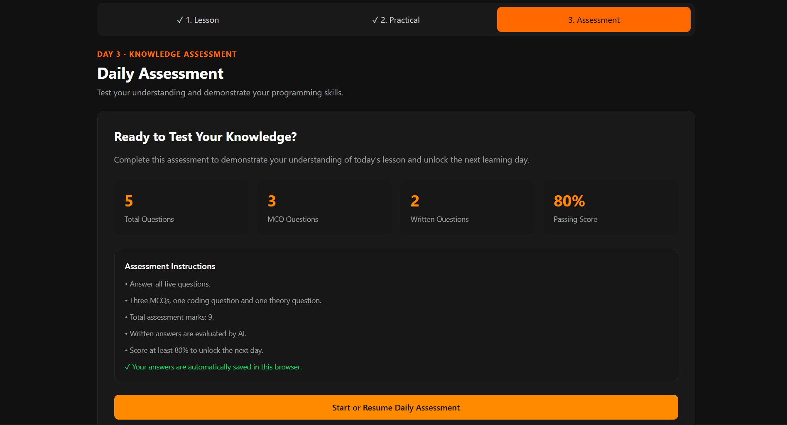

<p><strong>Daily Knowledge Evaluation</strong></p>

<p><em>Assessment-based progression with AI-assisted feedback and an 80% passing requirement.</em></p>

</div>

#### Learning Dashboard

<div align="center">

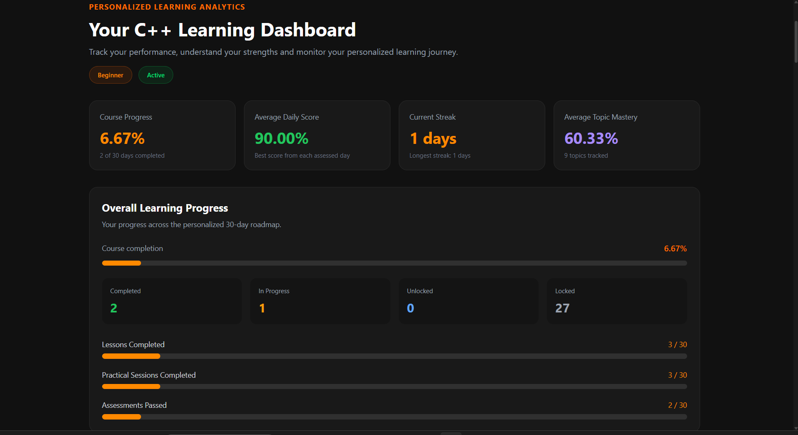

<p><strong>Personalized Learning Analytics Dashboard</strong></p>

<p><em>Track course completion, assessment performance, learning streaks, and topic-wise mastery.</em></p>

</div>

---

<a id="project-structure"></a>

## 📂 Project Structure

```text
codemind-ai/
│
├── backend/
│   ├── assistant/
│   │
│   ├── config/
│   │   ├── settings.py
│   │   ├── urls.py
│   │   └── wsgi.py
│   │
│   ├── repositories/
│   │
│   ├── learning/
│   │   ├── api/
│   │   └── services/
│   │
│   ├── media/
│   │   └── repositories/
│   │
│   ├── .venv/
│   ├── .env
│   ├── db.sqlite3
│   ├── manage.py
│   └── requirements.txt
│
├── frontend/
│   ├── public/
│   ├── src/
│   ├── dist/
│   ├── package.json
│   └── vite.config.ts
│
├── screenshots/
│   ├── CodeMind_System_Architecture.png
│   ├── daily-assessment.png
│   ├── daily-lesson.png
│   ├── image.png
│   ├── initial-assessment.png
│   ├── language-selection.png
│   ├── learning-dashboard.png
│   ├── learning-login.png
│   ├── personalized-roadmap.png
│   ├── practical-exercise.png
│   └── repository-answer.png
│
├── Caddyfile
├── .gitignore
└── README.md
```

> This is a simplified project structure. Environment variables, virtual environments, databases, generated repository data, and production build files are local runtime resources and should not be committed to GitHub.

---

<a id="installation-and-setup"></a>

## ⚙️ Installation and Setup

### Prerequisites

| Requirement | Download |
| :--- | :--- |
| Python | [python.org](https://www.python.org/downloads/) |
| Node.js and npm | [nodejs.org](https://nodejs.org/) |
| Git | [git-scm.com](https://git-scm.com/) |
| Ollama | [ollama.com](https://ollama.com/download) |
| Visual Studio Code | [code.visualstudio.com](https://code.visualstudio.com/) |
| Groq API Key | [Groq Developer Console](https://console.groq.com/keys) |

### Step 1 — Clone the Repository

Copy the repository URL from the GitHub **Code** button.

```powershell
git clone <repository-url>
cd codemind-ai
```

### Step 2 — Configure the Backend

```powershell
cd backend

python -m venv .venv

.\.venv\Scripts\Activate.ps1

pip install -r requirements.txt
```

### Step 3 — Configure Environment Variables

Create a `.env` file inside the `backend` directory.

```env
DJANGO_SECRET_KEY=your_django_secret_key
DJANGO_DEBUG=True

DJANGO_ALLOWED_HOSTS=localhost,127.0.0.1
DJANGO_CSRF_TRUSTED_ORIGINS=http://localhost:5173
DJANGO_CORS_ALLOWED_ORIGINS=http://localhost:5173

DJANGO_SECURE_COOKIES=False
DJANGO_TRUST_PROXY=False
DJANGO_SECURE_SSL_REDIRECT=False

GROQ_API_KEY=your_groq_api_key
```

Generate a Django secret key:

```powershell
python -c "from django.core.management.utils import get_random_secret_key; print(get_random_secret_key())"
```

Obtain a Groq API key from:

[https://console.groq.com/keys](https://console.groq.com/keys)

> [!IMPORTANT]
> Never commit the `.env` file, Django secret key, or Groq API key to GitHub.

### Step 4 — Apply Database Migrations

```powershell
python manage.py migrate
```

### Step 5 — Configure Ollama

Download the required local AI model:

```powershell
ollama pull qwen2.5-coder:3b
```

Start Ollama if it is not already running:

```powershell
ollama serve
```

### Step 6 — Start the Development Backend

```powershell
python manage.py runserver
```

Backend URL:

```text
http://127.0.0.1:8000
```

### Step 7 — Start the Development Frontend

Open a separate terminal from the project root:

```powershell
cd frontend

npm install

npm run dev
```

Frontend URL:

```text
http://localhost:5173
```

The application is now ready for local development.

---

<a id="production-deployment"></a>

## 🚀 Production Deployment

CodeMind AI uses a self-hosted production deployment with a public ngrok HTTPS tunnel.

### Deployment Architecture

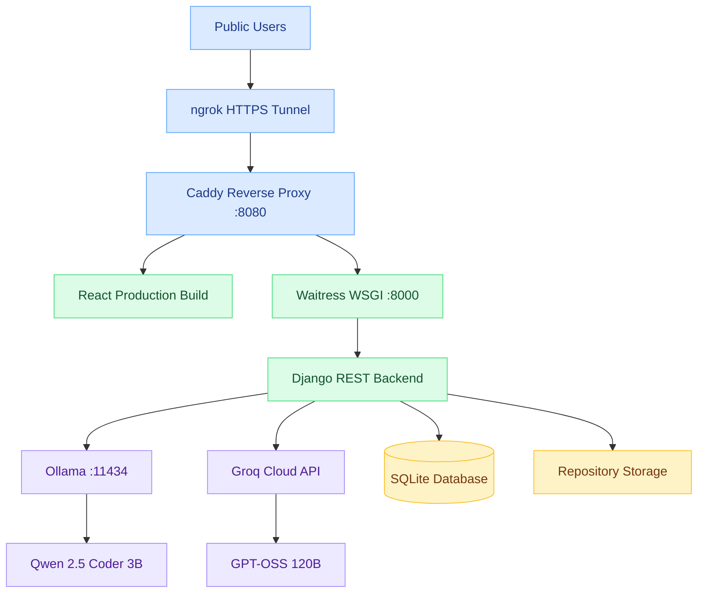

### Production Prerequisites

- Configured Ollama installation.
- Installed Waitress production server.
- Installed Caddy reverse proxy.
- Configured ngrok account and authentication token.
- Assigned ngrok development domain.
- Production environment variables.
- Completed database migrations.

### Step 1 — Build the Frontend

From the project root:

```powershell
cd frontend
npm run build
```

This generates the production frontend inside `frontend/dist`.

### Step 2 — Configure Production Environment

Update the existing `backend/.env` file:

```env
DJANGO_DEBUG=False

DJANGO_ALLOWED_HOSTS=localhost,127.0.0.1,vanish-stood-overhead.ngrok-free.dev

DJANGO_CSRF_TRUSTED_ORIGINS=https://vanish-stood-overhead.ngrok-free.dev

DJANGO_CORS_ALLOWED_ORIGINS=https://vanish-stood-overhead.ngrok-free.dev

DJANGO_SECURE_COOKIES=True
DJANGO_TRUST_PROXY=True
DJANGO_SECURE_SSL_REDIRECT=True
```

Retain the existing Django secret key and Groq API key.

For a different hosting environment, update the domain and frontend build directory in the `Caddyfile` and corresponding environment variables.

### Step 3 — Install Production Tools

Install Waitress inside the backend virtual environment if required:

```powershell
pip install waitress
```

Install Caddy on Windows:

```powershell
winget install --id CaddyServer.Caddy --exact
```

Install and configure ngrok using:

[https://ngrok.com/download](https://ngrok.com/download)

Configure your ngrok authentication token:

```powershell
ngrok config add-authtoken YOUR_NGROK_AUTHTOKEN
```

This authentication step is required only during initial setup.

### Step 4 — Start Production Services

Open four separate PowerShell terminals.

#### Terminal 1 — Ollama

```powershell
ollama serve
```

Skip this command if Ollama is already running.

#### Terminal 2 — Waitress

```powershell
cd D:\codemind-ai\backend

.\.venv\Scripts\Activate.ps1

waitress-serve --listen=127.0.0.1:8000 --threads=8 --max-request-body-size=62914560 --trusted-proxy=127.0.0.1 --trusted-proxy-headers=x-forwarded-proto config.wsgi:application
```

#### Terminal 3 — Caddy

```powershell
cd D:\codemind-ai

caddy run --config Caddyfile --adapter caddyfile
```

#### Terminal 4 — ngrok

```powershell
ngrok http --url=https://vanish-stood-overhead.ngrok-free.dev 8080
```

The commands above use the current deployment directory and assigned ngrok domain. Adjust these values when deploying on another machine.

### Step 5 — Verify Backend Health

```powershell
curl.exe -i -H "Host: vanish-stood-overhead.ngrok-free.dev" http://127.0.0.1:8080/api/health/
```

Expected response:

```text
HTTP/1.1 200 OK
```

The JSON response should contain:

```json
{
  "status": "healthy",
  "service": "codemind-ai-backend"
}
```

The actual response also includes a timestamp.

### Step 6 — Access the Application

<div align="center">

[](https://vanish-stood-overhead.ngrok-free.dev)

</div>

### Production Services

| Service | Port | Responsibility |
| :--- | :---: | :--- |
| Ollama | 11434 | Local Qwen inference |
| Waitress | 8000 | Django production server |
| Caddy | 8080 | Frontend serving and API reverse proxy |
| ngrok | Public HTTPS | Secure public application access |

### Deployment Cost

| Component | Cost |
| :--- | :--- |
| Frontend and Backend Frameworks | Free |
| Local Qwen Inference | Free |
| SQLite Database | Free |
| Waitress and Caddy | Free |
| Groq API | Free within applicable quotas |
| ngrok | Free within applicable quotas |
| Hosting Machine | Existing local computer |

**Hosting subscription cost: ₹0 within free-tier limits.**

Electricity and internet costs are not included.

> [!IMPORTANT]
> The host machine must remain powered on and connected to the internet. Ollama, Waitress, Caddy, and ngrok must remain running for public access.

### Restarting the Application

After reopening VS Code or restarting the host machine, start the four production services again.

There is no need to run `npm run dev` or `python manage.py runserver` during production hosting.

Rebuild the frontend using `npm run build` only when frontend changes require an updated production build.

---

<a id="security-and-resource-management"></a>

## 🔒 Security and Resource Management

CodeMind AI implements application-level security and resource protection mechanisms to support controlled public demonstrations.

### Security Features

| Security Mechanism | Description |
| :--- | :--- |
| User Authentication | Login and registration for Personalized Learning. |
| Session Isolation | Restricts repository access to the associated session. |
| CSRF Protection | Protects state-changing requests. |
| Secure Cookies | Enables HTTPS cookie configuration in production. |
| ZIP Validation | Validates uploaded repository archives. |
| Path Traversal Protection | Restricts extraction to permitted repository directories. |
| Sensitive File Filtering | Excludes recognized sensitive files from ingestion. |
| Upload Limits | Restricts archive size, extracted size, and file count. |
| API Rate Limiting | Controls excessive API requests. |
| AI Concurrency Limits | Restricts simultaneous resource-intensive operations. |
| Groq Usage Protection | Controls outgoing AI request frequency. |
| Repository Lifecycle | Removes inactive repository data through request-triggered cleanup. |
| Reverse Proxy Protection | Applies security headers and production route restrictions. |
| Environment Variables | Keeps API credentials outside committed source code. |

### Repository Resource Limits

| Resource | Configured Limit |
| :--- | :---: |
| Maximum ZIP Archive Size | 50 MiB |
| Maximum Extracted Archive Size | 200 MiB |
| Maximum Files | 1,000 |
| Maximum Individual File Size | 5 MiB |
| Repository Inactivity Retention | 24 Hours |

### Production Security

- Django debug mode disabled.
- HTTPS-enabled public access.
- Secure session and CSRF cookies.
- Restricted allowed hosts.
- Restricted trusted origins.
- Local backend and reverse proxy bindings.
- Blocked direct media and admin routes through Caddy.

These protections reduce common application risks but do not constitute a comprehensive security audit or guarantee suitability for unrestricted public hosting.

---

<a id="current-limitations"></a>

## ⚠️ Current Limitations

- Public availability depends on the local host machine.
- Local Qwen inference performance depends on available hardware.
- Groq and ngrok free-tier usage limits apply.
- Large repositories require additional parsing and indexing time.
- AI-generated answers may occasionally contain inaccuracies.
- Repository ingestion currently supports ZIP archives.
- Practical exercises do not include a dedicated code execution sandbox.
- SQLite is used for the current deployment.
- Rate-limiting state is maintained within the running backend process.
- Generated indexing artifacts do not have a comprehensive independent storage quota.

---

<a id="future-enhancements"></a>

## 🔮 Future Enhancements

- [ ] Direct GitHub repository integration.
- [ ] Additional source code file formats.
- [ ] Interactive repository dependency visualization.
- [ ] Advanced code quality analysis.
- [ ] Automated test case generation.
- [ ] Multi-turn repository-aware conversations.
- [ ] Secure programming execution sandbox.
- [ ] Additional programming courses.
- [ ] Exportable learning performance reports.
- [ ] Enhanced storage management and monitoring.
- [ ] Optional persistent cloud database integration.
- [ ] Optional scalable cloud deployment.

---

## 🎯 Project Applications

| Application | Use Case |
| :--- | :--- |
| Code Understanding | Explore unfamiliar software repositories. |
| Developer Onboarding | Understand project structure and implementation. |
| Technical Education | Learn programming through personalized roadmaps. |
| Interview Preparation | Strengthen programming concepts and practical skills. |
| Skill Assessment | Identify programming knowledge gaps. |
| Academic Projects | Demonstrate AI, machine learning, and full-stack integration. |
| Self-Paced Learning | Track individual learning progress and topic mastery. |

---

<a id="acknowledgements"></a>

## 🙏 Acknowledgements

CodeMind AI utilizes the following open-source technologies and AI platforms:

- [React](https://react.dev/)
- [TypeScript](https://www.typescriptlang.org/)
- [Django](https://www.djangoproject.com/)
- [Django REST Framework](https://www.django-rest-framework.org/)
- [Ollama](https://ollama.com/)
- [Qwen](https://github.com/QwenLM)
- [Groq](https://groq.com/)
- [SentenceTransformers](https://www.sbert.net/)
- [NumPy](https://numpy.org/)
- [Tailwind CSS](https://tailwindcss.com/)
- [Waitress](https://docs.pylonsproject.org/projects/waitress/)
- [Caddy](https://caddyserver.com/)
- [ngrok](https://ngrok.com/)

---

<div align="center">

# 🧠 CodeMind AI

### Understand Code. Learn Intelligently. Grow Continuously.

Built using Artificial Intelligence, Machine Learning, Retrieval-Augmented Generation, and Modern Web Technologies.

<br>

[](https://vanish-stood-overhead.ngrok-free.dev)

<br>

**⭐ If you find this project useful, consider starring the repository.**

</div>
